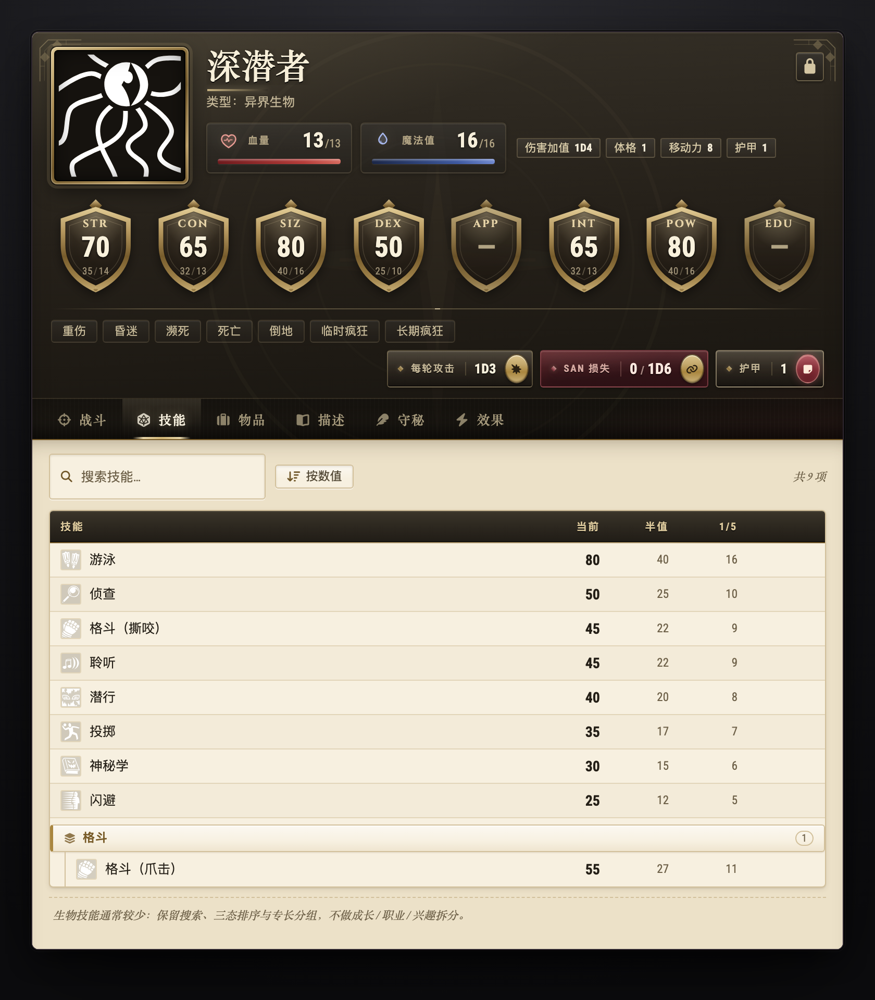

[中文](README.md) | **English**

# CoC7 Tidy Sheets
### coc7-tidy-investigator · Foundry VTT 14 · Call of Cthulhu 7e

Tidy 5e Sheets-style character sheets for **Call of Cthulhu 7e**:
an **Investigator** sheet, an **NPC / Creature** sheet and a **Container** sheet.
Opt-in registration — the system's default sheets are **never replaced**; pure Handlebars + CSS, no build step, no dependencies.

**Current version: 0.9.0** (2026-10-26) · [Release notes](https://github.com/JshGao/coc7-tidy-investigator/releases/latest)


v0.9 is a full visual overhaul: all three sheets now share a **1920s investigator dossier** language — dark lacquered banners, brass hairlines, aged paper, ink-black table headers and oxblood accents, typeset with locally bundled Cinzel / EB Garamond / Roboto Condensed. No feature or data changes.

---

## Visual language · "Investigator Dossier"


- **Banner (the cover)**: dark lacquer, brass side-light and oxblood vignette, with Art Deco corner ornaments; the portrait gets a 3px brass gradient frame.
- **Content area (the paper)**: aged paper base with fibre texture; tables use ink-black headers and brass hairlines, with a brass row tint on hover.
- **Hand-drawn SVG**: eight shield-shaped characteristic badges, HP / MP / SAN / Luck icons, section diamonds, empty-state star, dossier seal — all drawn inside the project, no external image dependencies.
- **Three bundled typefaces**: Cinzel (names / tabs / headings), EB Garamond (background and Keeper rich text), Roboto Condensed (data and tables); Chinese falls back to Songti / PingFang so mixed typesetting stays on the baseline.
- **Light and dark themes**: dark is not an inverted light theme but "ink leather with brass reflections"; compact mode and edit mode keep the same hierarchy.
- Tokens and component rules: [docs/05-美术风格设计.md](docs/05-美术风格设计.md) (Chinese).

All three typefaces are SIL Open Font License 1.1; the license files ship inside the module at `module/assets/fonts/licenses/`.

---

## Features

### Investigator sheet (`character`)

**Top banner**: portrait, name, lock / unlock, identity info (occupation, age, gender, …); HP / MP / SAN / Luck resource bars (drag to reorder once unlocked); Damage Bonus (DB) / Build / MOV / Armor; eight shield-shaped characteristic badges (inline inputs in edit mode); seven condition chips; a Daily SAN counter.
Click **SAN** or **Luck** to roll the matching check directly.

**Seven tabs**

| Tab | Contents |
|---|---|
| Skills | Search; sort by value / name / custom; specialization groups; growth marking; favorites; every skill keeps its own icon. In edit mode the columns split into Base / Occupation (Occ) / Personal (Int) / Development (Exp) / Value, all inline-editable. |
| Summary | Weapon quick reference (skill %, damage, range, attacks per round, ammo, malfunction) plus attack / roll damage; six categories of "invested" skill chips. |
| Possessions | Money strip (Credit Rating derived from the skill); sections for weapons / armor / books / spells / talents / items / statuses; collapsible groups; inline item quantities; drag to reorder in edit mode. |
| Background | Seven backstory cards (Personal Description / Ideology & Beliefs / Treasured Possessions / Meaningful Locations / Significant People / Traits / Injuries & Scars); multi-select key connections; backstory; encounters. |
| Growth | Three development point pools at a glance; "skills ready to grow" plus **Develop all** and manual value editing; per-check growth history grouped by an editable **module name** — change the post-growth value, undo a single record, create a new module. |
| Notes (GM) | Keeper notes (rich text), book reading progress, SAN loss events, Mythos Hardened / Mythos Insanity Experience flags, clear all conditions. |
| Effects | Create, click to configure, enable / disable, delete. |

**Also**: collapsible favorites sidebar (roll skills / attack with weapons / open items); context menus (open / add to or remove from favorites / delete); eight-way window resizing with size memory; compact mode; dark theme that follows Foundry.

### NPC / Creature sheet (`npc` + `creature`, new in v0.8)

- Banner: type / occupation info, HP / MP / SAN / Luck (empty values hidden), DB / Build / MOV / Armor, eight shield-shaped characteristic badges (missing values show `—`), condition chips, **attacks per round / SAN loss / armor**
- Six tabs: **Combat (default)** / Skills / Inventory / Description / Keeper (GM) / Effects
- Combat: attacks per round (rollable), SAN loss (creates the system's native link card), weapon table (attack / roll damage / shotgun range bands), special abilities quick reference, add or remove movement modes
- Edit mode: formula mode (characteristic formulas plus roll characteristics / average), auto-calculation toggles, inline resource and derived-value editing; inline skill values, item quantities and drag reordering
- Description and Keeper: `personalDescription` rich text, GM notes, dice macros (drag to add / execute / delete)
- Static mock: [prototype/npc.html](prototype/npc.html) · design document (Chinese): [docs/04-生物卡设计文档.md](docs/04-生物卡设计文档.md)

| NPC / Creature · Combat | Edit mode |
|---|---|
|  |  |

| Skills tab | Dark theme |
|---|---|
|  |  |

### Container sheet (`container`, new in v0.8)

- Compact banner: 96px portrait / name / item count / per-type count chips
- Four tabs: Contents (default) / Description / Keeper (GM) / Effects
- Contents: collapsible weapons / armor / books / spells / talents / items / statuses sections; quantity editing, drag reordering in edit mode, and a group `+` button
- Description / Keeper rich text (prose-mirror); fully data-compatible with the system's container sheet


---

## Screenshots

*The screenshots show the Chinese UI. Every label switches to English automatically when Foundry's language is set to English.*

| Summary | Possessions |
|---|---|
|  |  |

| Background | Growth |
|---|---|
|  |  |

| Notes (GM) | Effects |
|---|---|
|  |  |

| Skills in edit mode | Compact mode |
|---|---|
|  |  |

---

## Installation

### Option 1: Manifest URL (recommended)

Foundry VTT → **Add-on Modules** → **Install Module** → paste this into the **Manifest URL** field at the bottom:

```
https://raw.githubusercontent.com/JshGao/coc7-tidy-investigator/main/module/module.json
```

### Option 2: Manual installation

Download the zip from the [latest release](https://github.com/JshGao/coc7-tidy-investigator/releases/latest)
and extract it into `Data/modules/coc7-tidy-investigator/` (so that `module.json` sits directly in that folder).

### Enabling the sheets

1. Launch your world → **Module Management** → enable the CoC7 Tidy module
2. Open any investigator (`character`) actor → gear icon in the title bar, or right-click the actor → **Configure Sheet** → pick **CoC7 Tidy Investigator Sheet**
   (the NPC / Creature and Container sheets are selected the same way on their actors)

---

## Usage tips

- **Edit mode**: click the lock icon at the top-right of the banner to unlock before changing values; the locked state prevents accidental edits during play
- **Drag to reorder**: on the Skills tab switch sorting to **Custom**, then drag rows in edit mode; on the Possessions tab just drag in edit mode
- **Growth**: check **Mark** on the Skills tab → **Develop all** on the Growth tab; manual value edits (Cthulhu Mythos and the like) also happen in edit mode
- **Favorites**: right-click a skill / weapon / item → **Add to favorites**, then click it in the favorites sidebar on the left
- **Resource order**: unlock, then drag HP / MP / SAN / Luck to reorder them; the order is saved per actor
- **Settings**: Game Settings → Module Settings: Compact mode / Remember window size / Default skill sorting

---

## Compatibility

| Item | Version |
|---|---|
| Foundry VTT | 14 (verified on 14.368) |
| Call of Cthulhu 7e | ≥ 8.16 |

Dependencies: none. The module registers the `character`, `npc`, `creature` and `container` actor types, leaves the system's default sheets untouched and does not affect vehicles.

---

## Localization

- The sheet UI ships in **English** and **Chinese** and follows Foundry's language setting (Game Settings → Language Preference); no separate module or translation pack is needed
- Translations live in [`module/lang/en.json`](module/lang/en.json) and [`module/lang/cn.json`](module/lang/cn.json)
- Pull requests for additional languages are welcome

---

## Version history

- **0.9.0 (2026-10-26)**: "Investigator Dossier" visual overhaul. All three sheets now use dark lacquered banners / brass hairlines / aged paper / ink table headers / oxblood accents; Cinzel, EB Garamond and Roboto Condensed are bundled locally (OFL); shields, resource icons, corner ornaments and empty states redrawn; every promo screenshot and the cover regenerated. No feature or data changes.
  - Visual spec (Chinese): [docs/05-美术风格设计.md](docs/05-美术风格设计.md)
  - Changelog: [CHANGELOG.en.md](CHANGELOG.en.md)
- **0.8.3 (2026-10-22)**: Tidy NPC / Creature sheet + Container sheet; draggable resource cards on the investigator sheet; unified tab styling across the three sheets; edit-mode resource layout fix and assorted detail fixes.
  - Design document (Chinese): [docs/04-生物卡设计文档.md](docs/04-生物卡设计文档.md)
  - Static preview: [prototype/npc.html](prototype/npc.html)
- 0.7.2: stable investigator sheet.

---

## Development

```
module/                 module itself (contents of the release zip)
  module.json           manifest
  scripts/
    module.js           entry point: sheet registration, settings, template preloading
    constants.js        MODULE_ID / template paths / tabs / background slots / skill categories
    services/           pure data layer (view-data / tabs-data / npc-data / container-data)
    sheets/             AppV2 base class, investigator, NPC / creature, container
  templates/            Handlebars (investigator / npc / container / tabs / parts)
  styles/               tokens.css + sheet.css + npc.css + container.css
  assets/fonts/         three OFL typefaces (woff2) and licenses/
  lang/                 Chinese / English
docs/                   research notes, design documents, visual spec, screenshots
docs/promo/             cover source files and build script (not shipped in the zip)
prototype/              static visual mock-ups (open directly in a browser)
tools/                  headless render / screenshot / visual audit pipeline (dev only)
```

During development you can symlink the module into Foundry:

```bash
ln -s "$PWD/module" \
  "/Users/<you>/Library/Application Support/FoundryVTT/Data/modules/coc7-tidy-investigator"
```

> Notes: every AppV2 PART template must have exactly one root element; array fields (such as `system.biography`) cannot be submitted through a form `name` and have to be read and written back explicitly; development checks must be given the full `item.uuid`.

---

## Documentation

- [English feature guide](docs/03-promo.en.md): the tour of what the sheets do and why
- [Changelog (English)](CHANGELOG.en.md) · [更新日志](CHANGELOG.md)
- [Research report](docs/01-调研报告.md) (Chinese): CoC7 architecture, the Tidy design language, Foundry 14 API, compatibility red lines, including the NPC / creature data model appendix
- [Design document](docs/02-设计文档.md) (Chinese): layout, design tokens, components, interactions, data mapping, skill categories
- [NPC / Creature sheet design document](docs/04-生物卡设计文档.md) (Chinese): `npc` / `creature` / container sheet design (released in v0.8.3)
- [Visual style spec](docs/05-美术风格设计.md) (Chinese): the v0.9 "Investigator Dossier" language, tokens, components and render pipeline
- [宣传稿 / 功能导览](docs/03-宣传稿.md) (Chinese)

---

## License

- Code: [MIT](LICENSE)
- Fonts: Cinzel, EB Garamond and Roboto Condensed are all [SIL Open Font License 1.1](https://openfontlicense.org/); license files are bundled at `module/assets/fonts/licenses/`
- Shields / corner ornaments / icons: hand-drawn project SVG and CSS, no third-party artwork
