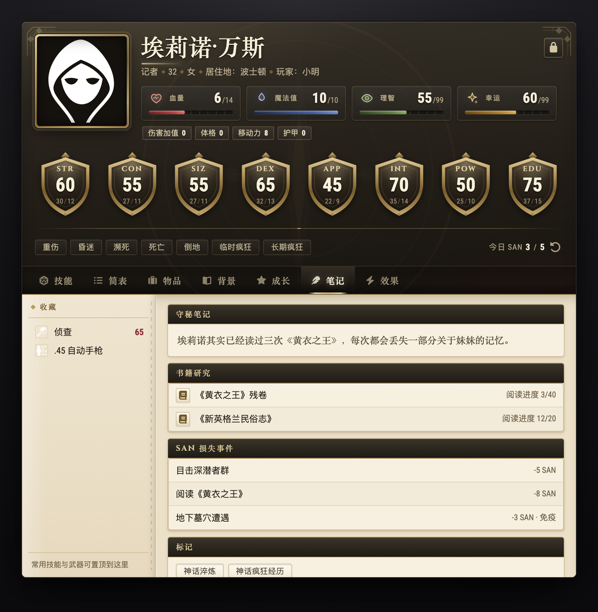
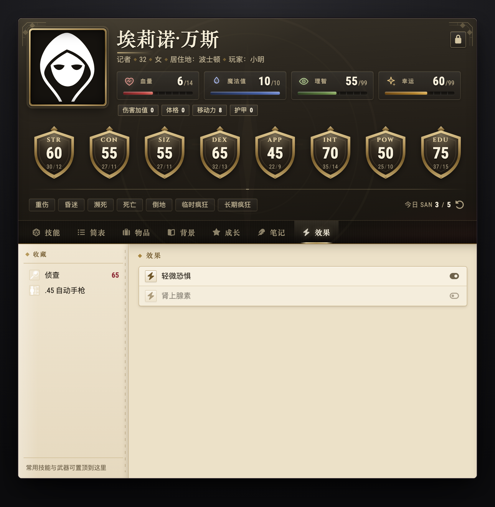
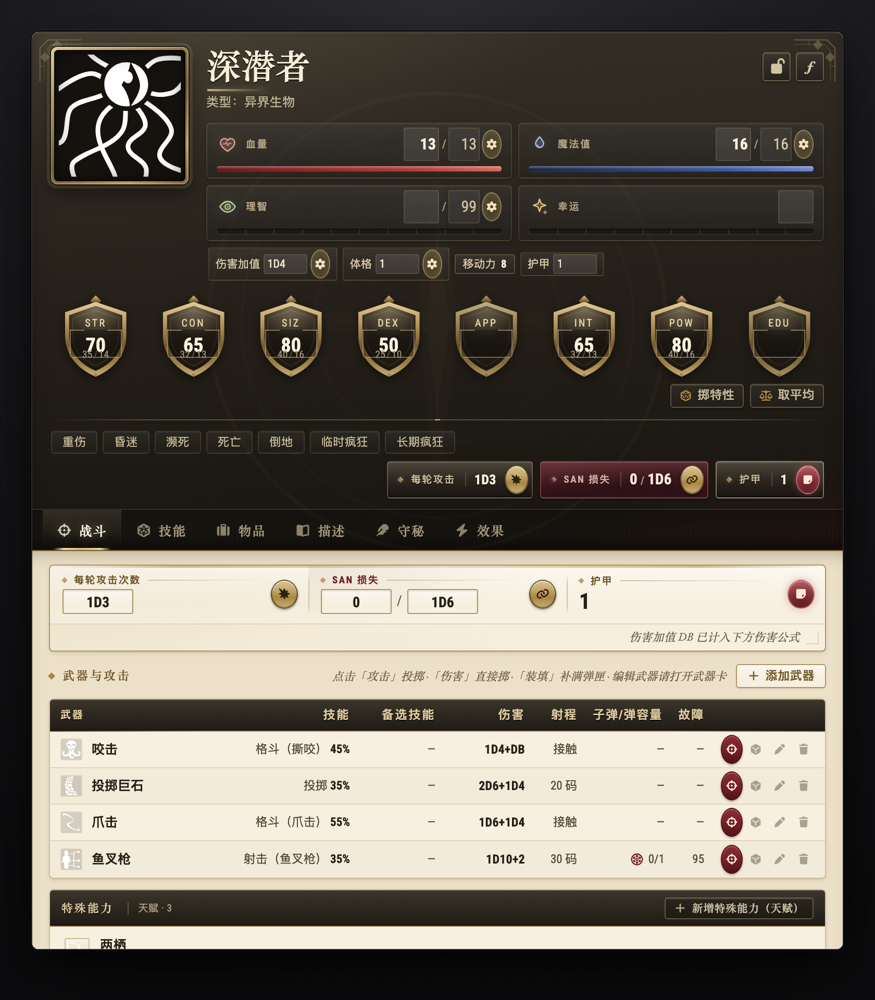

[中文](03-宣传稿.md) | **English**

# The investigator's desktop can be Tidy, too

**CoC7 Tidy Sheets · v0.9.0 "Investigator Dossier" release**
Foundry VTT 14 · Call of Cthulhu 7e (CoC7 ≥ 8.16)


*Screenshots show the Chinese UI; every label switches to English when Foundry's language is set to English.*

> Put what you need at the table exactly where your hands expect it.
>
> Three opt-in actor sheets: Investigator, NPC / Creature and Container.
> The system's default sheets stay untouched — install, play, switch back anytime.

---

## v0.9: the visual pass

This release brings all three sheets onto one **1920s investigator dossier** language. No feature or data changes:

- **Dark lacquered banner** with brass hairlines and Art Deco corner ornaments; the portrait gets a brass gradient frame
- **Aged paper content area**: ink table headers, brass section diamonds, card-stock panels — data stays high-contrast
- **Hand-drawn SVG**: eight shield-shaped characteristic badges, HP / MP / SAN / Luck icons, empty-state star and dossier seal, with no external images
- **Three locally bundled typefaces**: Cinzel (headings), EB Garamond (rich text), Roboto Condensed (data), with Chinese falling back to Songti / PingFang
- **Light and dark themes** share one hierarchy; dark is "ink leather with brass reflections", not an inverted light theme

All fonts are SIL Open Font License 1.1 and ship with the module.

---

## Why this sheet

The CoC7 system's built-in investigator sheet is feature-complete, yet at the table you keep repeating the same few moves: flipping through skills, working out half values, hunting for weapons, tallying growth.
This sheet does one thing — **put the information you reach for most up front and tuck the rare operations out of sight**.

- See it at a glance: HP, MP, SAN, Luck, Damage Bonus (DB) and the eight characteristics
- Check it on one page: skills, weapons, inventory, background, growth
- Settle it without the scramble: develop all with one click, records kept automatically, undo anytime

## Feature tour

### 1. The whole character on one screen


The top banner is the cockpit: resource bars, eight shield-shaped characteristics, condition chips for Critical Wounds / Unconscious / Dying / Dead / Prone / Temporary Insanity / Indefinite Insanity, and the Daily SAN counter.
Click SAN or Luck to roll the matching check; click a condition chip to toggle it.
Seven tabs run across the top: Skills / Summary / Possessions / Background / Growth / Notes / Effects.

### 2. Skills: find them, roll them, change them


- The search box filters instantly; sort by value / name / custom
- Specialization skills (Firearms, Fighting, …) collapse into groups automatically
- Favorited skills show a solid star; click them in the favorites sidebar on the left to roll
- Once unlocked, the table splits into Occupation / Personal / Development columns so you can edit points directly

### 3. Summary: the cockpit once the session is running


The weapon quick-reference table lists skill %, damage, range, rate, bullets / magazine and malfunction; click once to attack, then again to roll damage directly (Damage Bonus and half Damage Bonus handled for you). A revolver-cylinder button next to the count refills the magazine with one click; double-click the count to empty the magazine (Shift+double-click unloads a single round).
Below it are chips for the six categories of skills with points invested; combat skills stay visible, so you no longer flip back to the Skills tab mid-session.

### 4. Possessions: sort your own pack


Sections for weapons / armor / books / spells / talents / items / statuses; groups collapse, and you can drag to reorder them in edit mode.
Right-click any item to open / add to favorites / delete; edit quantities on the spot.

### 5. Background: the seven elements and key connections


Organized around the seven elements from the rulebook: Personal Description, Ideology & Beliefs, Treasured Possessions, Meaningful Locations, Significant People, Traits, and Injuries & Scars.
Check any of them as a key connection — multiple are allowed — and see at a glance what this character cares about most.

### 6. Growth: between-session bookkeeping without the scramble


Mark the skills you want to develop → Develop all runs the checks in a batch and clears the marks automatically.
Every check is recorded individually and grouped by an **editable module name**; adjust the post-growth value, undo a single record, or start a new growth module for this session.
Special skills such as Cthulhu Mythos can also be edited by hand.

### 7. Notes, Effects and the finer details





- Keeper notes, book reading progress, SAN loss events, Mythos flags, clear all conditions in one click
- Effects tab: create / open / toggle / delete
- Favorites sidebar, context menus, eight-way window resizing with size memory
- Compact mode: saves space on small screens or when the sheet gets dense


---

### 8. NPC / Creature sheet: the Keeper's combat panel

The same Tidy language, arranged the way a Keeper wants it:

- The banner puts **attacks per round, SAN loss and armor** up front, and the Combat tab opens by default
- Weapon table: click to attack, click again to roll damage (Damage Bonus and shotgun range bands handled for you); the ammo column shows bullets / magazine and a revolver-cylinder button reloads with one click (double-click the count to unload)
- Special abilities (talents) quick reference, add or remove movement modes, drop in a dice macro and use it
- Edit mode has **formula mode**: write `3D6*5` for a monster, then roll the characteristics or take the average with one click
- The Skills / Inventory / Description / Keeper tabs behave just like the investigator sheet





### 9. Container sheet: even the chest deserves to be tidy

A compact sheet for `container` actors: a 96px portrait, item count, chips summarized by type, and four tabs — Contents / Description / Keeper / Effects. Drag items in, edit quantities, reorder by dragging; fully data-compatible with the system's container sheet.


---

## Installation

Foundry VTT → Add-on Modules → Install Module → paste this into the **Manifest URL** field at the bottom:

```
https://raw.githubusercontent.com/JshGao/coc7-tidy-investigator/main/module/module.json
```

After installing, enable it under Module Management, then open an actor's Configure Sheet and choose **CoC7 Tidy Investigator Sheet**, **CoC7 Tidy NPC / Creature Sheet** or **CoC7 Tidy Container Sheet**.

- Fully opt-in: the system's default sheets are never replaced — switch back anytime
- Data-compatible: uses CoC7's native data structures and adds no extra data
- No dependencies: pure Handlebars + CSS, no build step
- Open source: MIT licensed; issues and PRs welcome
- Fonts: Cinzel / EB Garamond / Roboto Condensed are all OFL 1.1 and ship with the module

Repository: <https://github.com/JshGao/coc7-tidy-investigator>

---

## Who it's for

- CoC7 players who find the default sheet scattered and are always hunting for something mid-session
- Keepers who want new players to get up to speed quickly
- Anyone who likes the layout of Tidy 5e Sheets
- Anyone who wants their character sheet to feel like an archive, not a game HUD

---

## Share copy

> **CoC7 Tidy Sheets · v0.9.0 "Investigator Dossier"**
>
> CoC7 character sheets that feel more like table tools — and look the part:
> dark lacquered banners / brass hairlines / aged paper / oxblood accents, with Cinzel + EB Garamond + Roboto Condensed bundled locally.
> Investigator sheet (seven tabs / searchable skills / develop all), NPC / Creature sheet (attacks per round / SAN loss / characteristic formulas) and Container sheet.
> Opt-in install, the system sheets stay untouched, no extra data.
>
> Install — Add-on Modules → Install Module → Manifest URL:
> `https://raw.githubusercontent.com/JshGao/coc7-tidy-investigator/main/module/module.json`
>
> Repository: https://github.com/JshGao/coc7-tidy-investigator

**One-liner**

> CoC7 character sheets, given the Tidy treatment and a 1920s dossier look: Investigator, NPC / Creature and Container sheets, ready for Foundry VTT 14.
> https://github.com/JshGao/coc7-tidy-investigator
